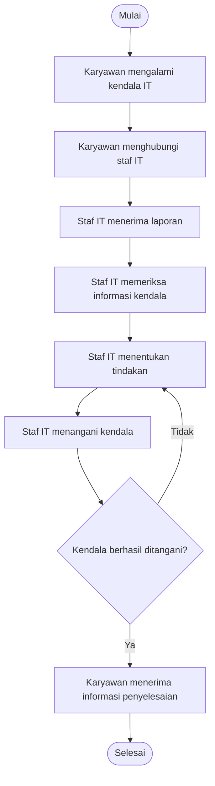
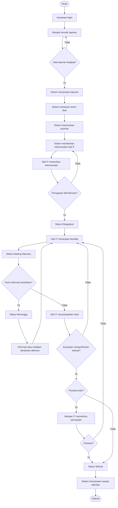

# Business Process Analysis
## Sistem Helpdesk IT Perusahaan

### 1. Pendahuluan

Business Process Analysis merupakan proses analisis terhadap alur kegiatan operasional untuk memahami bagaimana suatu proses berjalan, mengidentifikasi kendala, serta merancang proses bisnis yang lebih efektif.

Pada proyek Sistem Helpdesk IT Perusahaan, analisis dilakukan terhadap proses pelaporan dan penanganan kendala teknologi informasi yang dialami karyawan.

Dokumen ini menjelaskan dua kondisi proses bisnis:

1. **As-Is Process:** Gambaran proses bisnis sebelum sistem Helpdesk IT diterapkan.
2. **To-Be Process:** Gambaran proses bisnis yang diusulkan setelah sistem Helpdesk IT diterapkan.

Analisis ini disusun berdasarkan skenario operasional perusahaan dan masih memerlukan validasi stakeholder sebelum implementasi pada lingkungan perusahaan sebenarnya.

---

### 2. Tujuan Analisis Proses Bisnis

Analisis proses bisnis ini bertujuan untuk:

1. Memahami alur pelaporan kendala IT yang berjalan saat ini.
2. Mengidentifikasi hambatan dalam proses pelaporan dan penanganan kendala.
3. Menentukan kebutuhan perubahan proses bisnis.
4. Merancang alur penanganan laporan yang lebih terstruktur.
5. Memperjelas tanggung jawab setiap pengguna yang terlibat.
6. Meningkatkan transparansi dan dokumentasi penanganan kendala IT.

---

### 3. Stakeholder dan Peran Pengguna

Sistem Helpdesk IT melibatkan empat jenis pengguna utama.

| Stakeholder | Tanggung Jawab |
|---|---|
| Administrator | Mengelola akun pengguna, data master, kategori laporan, dan konfigurasi sistem. |
| Karyawan | Membuat laporan kendala IT dan memantau perkembangan laporan. |
| Staf IT | Memeriksa laporan, mengonfirmasi penugasan, menangani kendala, dan memperbarui status. |
| Manajer IT | Mengawasi penanganan laporan, memantau kendala kritis, dan mengevaluasi layanan IT. |

**Penjelasan tanggung jawab:**

- Administrator bertanggung jawab terhadap pengelolaan administrasi sistem, bukan sebagai penanggung jawab seluruh penyelesaian kendala.
- Karyawan menjadi pihak yang melaporkan kendala dan memberikan konfirmasi atas hasil penyelesaian.
- Staf IT menjadi pihak yang melakukan pemeriksaan dan penanganan teknis.
- Manajer IT bertanggung jawab terhadap pengawasan dan keputusan eskalasi untuk kendala kritis.

---

### 4. Analisis Proses Bisnis Saat Ini (As-Is)

#### 4.1 Gambaran Proses

Berdasarkan skenario yang digunakan, pelaporan kendala IT diasumsikan masih dilakukan melalui komunikasi informal, seperti WhatsApp atau komunikasi langsung kepada staf IT.

Informasi laporan diterima oleh tim IT, kemudian ditindaklanjuti berdasarkan informasi yang tersedia dan kondisi pekerjaan staf.

Proses tersebut belum memiliki mekanisme terpusat untuk mencatat seluruh laporan, mengklasifikasikan prioritas, memantau status, serta mendokumentasikan riwayat penanganan.

#### 4.2 Alur Proses As-Is

1. Karyawan mengalami kendala pada perangkat atau layanan IT.
2. Karyawan menghubungi staf IT melalui WhatsApp atau komunikasi langsung.
3. Staf IT menerima informasi kendala.
4. Staf IT melakukan pemeriksaan awal berdasarkan informasi yang diterima.
5. Staf IT menentukan tindakan penanganan secara manual.
6. Staf IT melakukan perbaikan.
7. Karyawan menerima informasi hasil penanganan.
8. Proses dianggap selesai setelah kendala berhasil ditangani.

#### 4.3 Diagram Alur As-Is

#### 4.4 Permasalahan pada Proses As-Is

| No. | Permasalahan | Dampak |
|---|---|---|
| 1 | Laporan disampaikan melalui komunikasi informal. | Risiko laporan terlewat atau tidak tercatat. |
| 2 | Informasi laporan tidak memiliki format standar. | Informasi awal dapat kurang lengkap. |
| 3 | Belum terdapat klasifikasi prioritas yang konsisten. | Kendala kritis berpotensi terlambat ditangani. |
| 4 | Penugasan dilakukan secara manual. | Pembagian pekerjaan sulit dipantau. |
| 5 | Tidak tersedia pemantauan status terpusat. | Karyawan harus menanyakan perkembangan laporan. |
| 6 | Riwayat penanganan tidak terdokumentasi secara sistematis. | Evaluasi layanan IT menjadi lebih sulit. |

---

### 5. Analisis Proses Bisnis yang Diusulkan (To-Be)

#### 5.1 Gambaran Proses

Pada proses bisnis yang diusulkan, seluruh laporan kendala IT disampaikan melalui sistem Helpdesk IT berbasis web.

Setiap laporan akan memiliki identitas tiket yang dapat digunakan untuk memantau perkembangan penanganan.

Sistem menyediakan mekanisme kategorisasi kendala dan penentuan prioritas berdasarkan dampak serta urgensi.

Sistem juga dapat memberikan rekomendasi penugasan kepada staf IT. Rekomendasi tersebut tidak langsung menjadi penugasan final karena staf IT perlu melakukan konfirmasi.

Manajer IT dapat memantau laporan, mengawasi kendala kritis, dan melakukan evaluasi terhadap proses penanganan.

#### 5.2 Alur Proses To-Be

1. Karyawan login ke sistem Helpdesk IT.
2. Karyawan mengisi formulir laporan kendala IT.
3. Karyawan memasukkan judul, deskripsi, kategori, dampak, urgensi, dan lampiran jika diperlukan.
4. Sistem memvalidasi kelengkapan informasi laporan.
5. Sistem menyimpan laporan dan membuat nomor tiket.
6. Sistem menentukan rekomendasi prioritas berdasarkan dampak dan urgensi.
7. Sistem memberikan rekomendasi penugasan kepada staf IT yang sesuai.
8. Staf IT memeriksa laporan dan mengonfirmasi penugasan.
9. Status tiket berubah menjadi Ditugaskan.
10. Staf IT mulai melakukan penanganan dan memperbarui status menjadi Sedang Diproses.
11. Jika membutuhkan informasi atau tindakan tambahan, tiket dapat diubah menjadi Menunggu.
12. Setelah perbaikan dilakukan, staf IT menyampaikan hasil penyelesaian kepada karyawan.
13. Karyawan memberikan konfirmasi apakah kendala sudah terselesaikan.
14. Jika karyawan menyatakan kendala belum terselesaikan, tiket dikembalikan untuk ditangani kembali.
15. Jika karyawan menyatakan kendala telah terselesaikan, tiket dapat diproses untuk penutupan.
16. Untuk tiket kritis, Manajer IT melakukan pemeriksaan dan persetujuan penutupan.
17. Sistem mencatat seluruh aktivitas ke dalam riwayat tiket.
18. Tiket dinyatakan Selesai setelah persyaratan penutupan terpenuhi.

#### 5.3 Diagram Alur To-Be

---

### 6. Perbandingan Proses As-Is dan To-Be

| Aspek | As-Is | To-Be |
|---|---|---|
| Pelaporan | WhatsApp atau komunikasi langsung | Sistem Helpdesk berbasis web |
| Dokumentasi | Belum terpusat | Tersimpan dalam sistem |
| Nomor laporan | Tidak selalu tersedia | Nomor tiket otomatis |
| Kategorisasi | Dilakukan secara informal | Menggunakan kategori laporan |
| Prioritas | Belum konsisten | Berdasarkan dampak dan urgensi |
| Penugasan | Manual | Rekomendasi sistem dan konfirmasi staf IT |
| Pemantauan | Melalui komunikasi langsung | Dashboard dan status tiket |
| Riwayat penanganan | Tidak sistematis | Ticket history |
| Pengawasan | Informasi diterima secara manual | Dashboard Manajer IT |
| Penutupan | Berdasarkan komunikasi | Konfirmasi penyelesaian dan aturan penutupan |

---

### 7. Aturan Bisnis (Business Rules)

Aturan bisnis merupakan ketentuan yang harus diikuti agar proses operasional sistem berjalan secara konsisten.

| Kode | Aturan Bisnis |
|---|---|
| BR-01 | Setiap laporan kendala IT harus dibuat melalui sistem Helpdesk oleh pengguna yang memiliki akses. |
| BR-02 | Setiap laporan harus memiliki judul, deskripsi, kategori, dampak, dan urgensi. |
| BR-03 | Sistem membuat nomor tiket unik untuk setiap laporan. |
| BR-04 | Prioritas ditentukan berdasarkan kombinasi dampak dan urgensi. |
| BR-05 | Rekomendasi penugasan dari sistem harus dikonfirmasi oleh staf IT. |
| BR-06 | Setiap perubahan status tiket harus tercatat dalam riwayat aktivitas. |
| BR-07 | Karyawan hanya dapat memantau laporan yang menjadi hak aksesnya. |
| BR-08 | Staf IT dapat memperbarui status dan mencatat hasil penanganan sesuai kewenangannya. |
| BR-09 | Karyawan diminta memberikan konfirmasi atas hasil penyelesaian kendala. |
| BR-10 | Tiket kritis memerlukan pemeriksaan dan persetujuan Manajer IT sebelum penutupan. |
| BR-11 | Tiket nonkritis dapat diproses untuk penutupan setelah karyawan mengonfirmasi penyelesaian. |
| BR-12 | Sistem menyimpan riwayat pelaporan, penugasan, perubahan status, dan penyelesaian tiket. |

---

### 8. Status dan Alur Perubahan Tiket

Sistem menggunakan lima status utama.

| Status | Keterangan |
|---|---|
| Baru | Laporan telah dibuat dan menunggu proses pemeriksaan atau penugasan. |
| Ditugaskan | Laporan telah dikonfirmasi untuk ditangani oleh staf IT. |
| Sedang Diproses | Staf IT sedang melakukan pemeriksaan atau perbaikan. |
| Menunggu | Penanganan sementara menunggu informasi, persetujuan, atau tindakan tambahan. |
| Selesai | Kendala telah diselesaikan dan persyaratan penutupan telah dipenuhi. |

**Ketentuan perubahan status:**

- Baru → Ditugaskan: penugasan telah dikonfirmasi staf IT.
- Ditugaskan → Sedang Diproses: staf IT mulai menangani kendala.
- Sedang Diproses → Menunggu: diperlukan informasi atau tindakan tambahan.
- Menunggu → Sedang Diproses: informasi atau tindakan tambahan telah diterima.
- Sedang Diproses → Selesai: hasil penyelesaian telah dikonfirmasi dan persyaratan penutupan dipenuhi.

Status Selesai tidak boleh diberikan hanya karena staf IT telah melakukan perbaikan. Konfirmasi dan aturan persetujuan penutupan tetap harus diperhatikan.

---

### 9. Penanganan Kondisi Khusus (Exception Handling)

Selain alur normal, sistem perlu memperhatikan kondisi khusus berikut.

| No. | Kondisi | Penanganan yang Diusulkan |
|---|---|---|
| 1 | Data laporan tidak lengkap | Sistem meminta karyawan melengkapi informasi sebelum laporan disimpan. |
| 2 | Lampiran gagal diunggah | Sistem memberikan informasi kegagalan dan meminta pengguna mencoba kembali. |
| 3 | Tidak ada staf IT yang tersedia | Laporan tetap tersimpan dan menunggu penugasan. |
| 4 | Staf IT menolak rekomendasi penugasan | Sistem meminta alasan dan memungkinkan rekomendasi penugasan ulang. |
| 5 | Kendala belum terselesaikan | Tiket dikembalikan ke proses penanganan. |
| 6 | Tiket kritis membutuhkan keputusan | Manajer IT menerima eskalasi untuk melakukan pemeriksaan. |
| 7 | Karyawan belum memberikan konfirmasi | Tiket tetap menunggu konfirmasi sesuai kebijakan perusahaan. |
| 8 | Sistem mengalami gangguan | Laporan dapat dicatat melalui prosedur darurat sementara dan dimasukkan ke sistem setelah layanan pulih. |

---

### 10. Mekanisme Eskalasi dan Penutupan Tiket

#### 10.1 Eskalasi Tiket Kritis

Tiket dengan prioritas kritis memerlukan perhatian khusus karena dapat memengaruhi operasional perusahaan.

Proses eskalasi yang diusulkan:

1. Sistem mengidentifikasi laporan dengan prioritas kritis.
2. Sistem menampilkan laporan pada pemantauan Manajer IT.
3. Manajer IT memperoleh informasi terkait dampak, urgensi, dan perkembangan penanganan.
4. Manajer IT dapat meminta percepatan atau tindakan lanjutan.
5. Setelah staf IT menyelesaikan kendala, hasil penanganan disampaikan kepada karyawan.
6. Setelah karyawan mengonfirmasi penyelesaian, Manajer IT memeriksa dan memberikan persetujuan penutupan.
7. Sistem mengubah status tiket menjadi Selesai setelah persetujuan diberikan.

#### 10.2 Penutupan Otomatis

Untuk mendukung efisiensi, sistem direncanakan memiliki mekanisme penutupan otomatis setelah 24 jam dalam kondisi tertentu.

Ketentuannya:

- Penutupan otomatis hanya berlaku untuk tiket nonkritis yang telah memenuhi persyaratan penyelesaian.
- Tiket kritis tidak boleh ditutup otomatis tanpa pemeriksaan dan persetujuan Manajer IT.
- Tiket yang masih berstatus Menunggu atau belum memenuhi persyaratan penyelesaian tidak boleh ditutup otomatis.
- Sistem mencatat waktu dan alasan penutupan ke dalam ticket history.

Kebijakan ini masih perlu divalidasi dan disepakati bersama stakeholder sebelum implementasi.

---

### 11. Kebutuhan Perbaikan Proses Bisnis

Berdasarkan perbandingan proses As-Is dan To-Be, perbaikan yang diusulkan meliputi:

1. Sentralisasi laporan melalui aplikasi Helpdesk IT.
2. Standarisasi informasi laporan agar mudah dipahami tim IT.
3. Penerapan klasifikasi prioritas berdasarkan dampak dan urgensi.
4. Penerapan mekanisme rekomendasi dan konfirmasi penugasan.
5. Penyediaan pemantauan status tiket secara terpusat.
6. Pencatatan aktivitas dan riwayat penanganan.
7. Penerapan mekanisme eskalasi untuk kendala kritis.
8. Penerapan prosedur konfirmasi penyelesaian dan penutupan tiket.

---

### 12. Indikator Keberhasilan Proses (Proposed KPIs)

Indikator berikut merupakan usulan untuk mengukur efektivitas sistem setelah diterapkan.

| KPI | Tujuan Pengukuran |
|---|---|
| Jumlah laporan masuk | Mengukur volume laporan kendala IT. |
| Waktu respons awal | Mengukur waktu sejak laporan dibuat hingga pertama kali ditindaklanjuti. |
| Waktu penyelesaian | Mengukur waktu sejak laporan dibuat hingga dinyatakan selesai. |
| Persentase tiket selesai | Mengukur jumlah tiket yang berhasil diselesaikan dibandingkan jumlah tiket yang masuk dalam periode pengukuran. |
| Jumlah tiket kritis | Mengukur volume kendala dengan dampak dan urgensi tinggi. |
| Tiket melewati target layanan | Mengidentifikasi laporan yang membutuhkan evaluasi atau eskalasi. |
| Tingkat konfirmasi penyelesaian | Mengukur persentase tiket selesai yang telah dikonfirmasi oleh pelapor. |

Target angka untuk setiap KPI akan ditentukan setelah perusahaan memiliki data awal dan kesepakatan tingkat layanan (SLA).

---

### 13. Asumsi dan Batasan Analisis

Analisis proses bisnis ini memiliki beberapa asumsi:

1. Perusahaan memiliki tim IT internal yang bertanggung jawab menangani kendala teknologi informasi.
2. Karyawan memiliki akun untuk mengakses sistem.
3. Staf IT memiliki pembagian tanggung jawab penanganan kendala.
4. Manajer IT bertugas mengawasi proses penanganan laporan.
5. Sistem digunakan untuk mengelola kendala IT internal perusahaan.
6. Penentuan prioritas menggunakan kombinasi dampak dan urgensi.
7. Penugasan yang direkomendasikan sistem tetap memerlukan konfirmasi staf IT.

Batasan analisis:

- Dokumen belum menggambarkan prosedur operasional perusahaan tertentu.
- Alur bisnis masih berupa rancangan berdasarkan skenario.
- Kebijakan SLA, matriks prioritas, dan ketentuan penutupan perlu divalidasi stakeholder.
- Sistem tidak berfokus pada pengelolaan aset IT secara menyeluruh.
- Integrasi dengan WhatsApp atau aplikasi eksternal belum menjadi bagian dari ruang lingkup utama.

---

### 14. Kesimpulan

Berdasarkan analisis proses bisnis, proses pelaporan kendala IT yang mengandalkan komunikasi informal memiliki risiko dalam hal dokumentasi, penentuan prioritas, penugasan, pemantauan, dan evaluasi penanganan.

Sistem Helpdesk IT berbasis web diusulkan untuk menyediakan proses pelaporan yang terpusat, penentuan prioritas yang lebih konsisten, pengelolaan penugasan, pemantauan status, serta pencatatan riwayat aktivitas.

Dengan adanya proses bisnis To-Be, diharapkan pengelolaan kendala IT menjadi lebih terstruktur, transparan, dan mudah dievaluasi.

Dokumen ini menjadi dasar untuk menyusun Business Requirements Document (BRD) dan Software Requirements Specification (SRS) pada tahap analisis kebutuhan sistem berikutnya.

---

**Dokumen:** Business Process Analysis  
**Proyek:** Sistem Helpdesk IT Perusahaan  
**Tahap:** Business Analysis  
**Status:** Draft Analisis – Memerlukan Validasi Stakeholder
